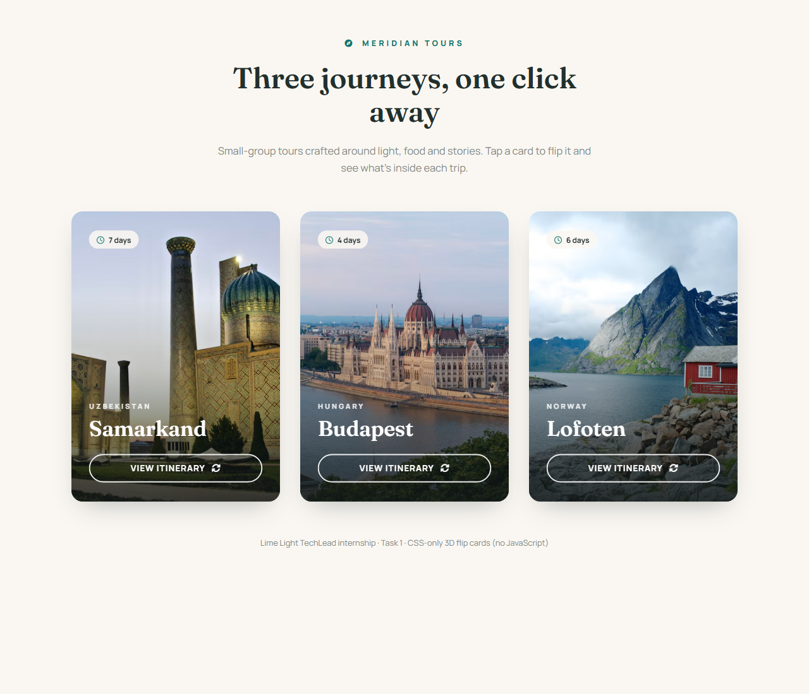
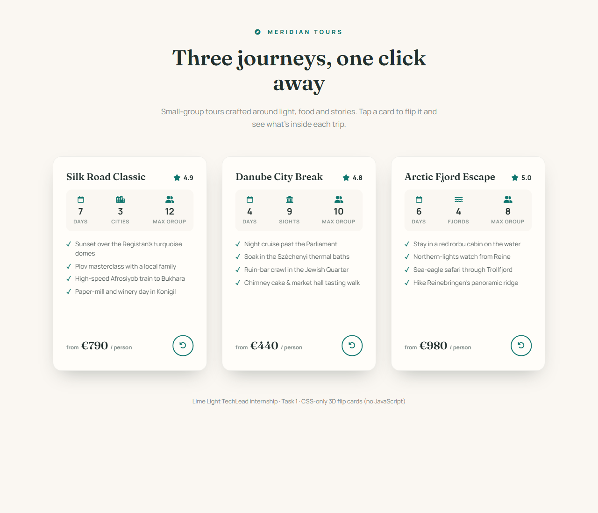

# Meridian Tours — CSS 3D Clickable Flip Cards

**Task 1** of the Lime Light TechLead internship: an original take on CSS-only 3D flip cards,
redesigned as a landing page for a fictional travel agency, **Meridian Tours**, promoting three
small-group tour packages — Samarkand (Uzbekistan), Budapest (Hungary) and Lofoten (Norway).

| Front | Back |
| --- | --- |
|  |  |

## How it works

No JavaScript — the flip is pure CSS, driven by the classic checkbox hack:

1. Each card contains a hidden `<input type="checkbox">`.
2. The "View itinerary" and return buttons are `<label>` elements pointing at that checkbox.
3. When checked, the sibling `.content` block rotates in 3D:

```scss
.flip-toggle:checked ~ .content {
    transform: rotateX(-180deg);
}
```

The 3D effect comes from `perspective` on the card, `transform-style: preserve-3d` on the
rotating block, and `backface-visibility: hidden` on both faces. The back face is pre-rotated
`rotateX(180deg)` so it reads correctly after the flip.

## What's different from the sample

- **Vertical flip** (`rotateX`) instead of the sample's horizontal `rotateY`
- **Portrait cards** (330×460) instead of landscape
- Different product (tour packages), layout (flexbox faces instead of grid), typography
  (Fraunces + Manrope), and a terracotta-on-cream palette
- Extra touches: hover lift on the cards, duration chip, stats bar, check-marked highlights
  list, page header/footer, and a responsive layout for mobile

## Files

- `index.html` — structure (three cards + header/footer)
- `scss/style.scss` — SCSS source (variables, nesting)
- `css/style.css` — compiled CSS, the file `index.html` actually links (so GitHub Pages
  works without a build step)

To recompile after editing the SCSS: `npx sass scss/style.scss css/style.css`

## Credits

- Based on the task sample by [Lime-Light-TechLead](https://github.com/Lime-Light-TechLead/CSS-3D-clickable-flip-cards)
- Photos from [Unsplash](https://unsplash.com), icons from [Font Awesome](https://fontawesome.com),
  fonts from [Google Fonts](https://fonts.google.com)
